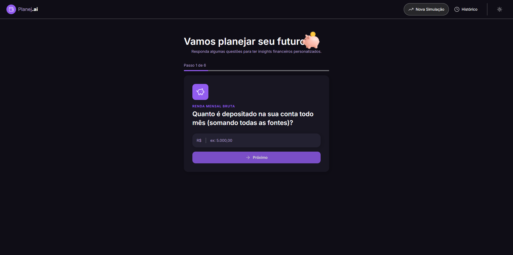
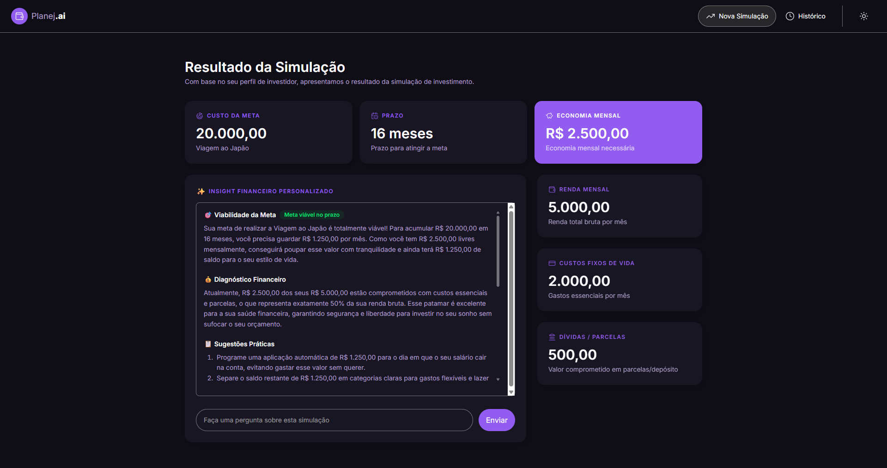
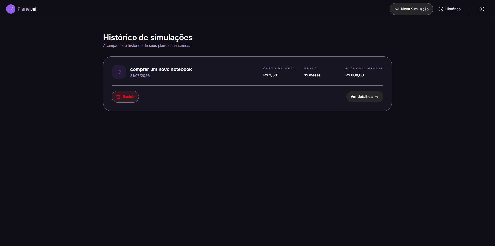

# Planej.ai

Uma aplicação React + TypeScript desenvolvida com Vite para simulações financeiras e insights personalizados por IA.

> Este repositório contém o frontend da aplicação **Planej.ai** — um assistente de planejamento financeiro que gera simulações, calcula economia mensal e oferece insights acionáveis por IA.

---

## Demo

- **URL (local dev):** `http://localhost:5174/`
- **Link da aplicação (produção):** _Adicione aqui o link do deploy_

---

## Capturas / Mockups

As imagens abaixo usam arquivos committed no repositório para que o `README` mostre as prévias corretamente.

- Banner / Hero: `src/assets/Hero.png`
- Tela de Simulação: `src/assets/simulação.png`
- Tela de Histórico: `src/assets/Histórico.png`





> Se preferir, você também pode usar placeholders em `src/assets/images/` como `hero-placeholder.svg`, `history-desktop.svg` e `insight-chat.svg`.

---

## Principais funcionalidades

- **Simulações completas:** entrada de dados de renda, despesas, dívidas e metas.
- **Resumo financeiro:** cálculo automático de economia mensal e cartões com métricas chave.
- **Insights por IA:** diagnóstico, sugestões práticas e mensagem motivacional.
- **Chat contextual:** perguntas e respostas por simulação com histórico salvo no `localStorage`.
- **Histórico de simulações:** visualização, exclusão e navegação para resultados anteriores.

---

## Tecnologias

- React 19
- TypeScript
- Vite
- Tailwind CSS
- Lucide Icons
- Gemini / API de linguagem (via `VITE_GEMINI_API_KEY`)

---

## Como rodar localmente

### Pré-requisitos

- Node.js (LTS recomendado)
- npm

### Passos

1. Clone o repositório:
   ```bash
   git clone https://github.com/AlbericoJr/planejai.git
   cd planejai
   ```
2. Instale as dependências:
   ```bash
   npm ci
   ```
3. Crie um arquivo `.env` com a chave da API (opcional para testar IA):
   ```env
   VITE_GEMINI_API_KEY=your_api_key_here
   ```
4. Inicie o servidor de desenvolvimento:
   ```bash
   npm run dev
   ```
5. Abra `http://localhost:5174/` no navegador.

---

## Scripts úteis

- `npm run dev` — inicia o servidor de desenvolvimento com HMR.
- `npm run build` — compila o projeto para produção.
- `npm run preview` — pré-visualiza o build produzido.
- `npm run lint` — executa o ESLint.
- `npm run format` — formata o código com Prettier.

---

## Estrutura do projeto

- `src/` — código-fonte principal
  - `components/` — componentes React organizados por feature
  - `pages/` — telas da aplicação
  - `hooks/` — hooks customizados
  - `services/` — integração com API de IA
  - `data/` — tipos e templates de prompt
  - `utils/` — utilitários
- `public/` — assets estáticos
- `src/assets/` — imagens usadas pelo app e pelo README

---

## Configurações importantes

- `VITE_GEMINI_API_KEY` — chave para a API generativa. Mantenha essa chave fora do repositório.

> Em produção, evite expor chaves sensíveis no cliente. Use um backend ou proxy para proteger a API.

---

## Testando o chat / IA

1. Execute `npm run dev` e gere uma simulação.
2. Acesse a página de resultados e aguarde o insight da IA.
3. Use o campo de conversa no card de insight para enviar perguntas adicionais.
4. O histórico de cada simulação é salvo no `localStorage`.

---

## Contribuição

- Abra uma issue com sugestões ou bugs.
- Faça um branch com `feat/` ou `fix/`.
- Envie um pull request com descrição clara das alterações.

---

## Licença

- MIT (ou ajuste para a licença desejada)

---

## Contato

- Autor: `AlbericoJr`
- Repo: `https://github.com/AlbericoJr/planejai`
