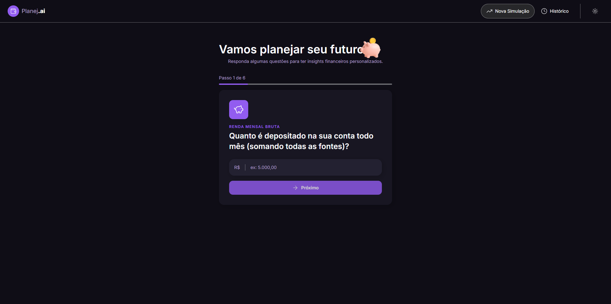
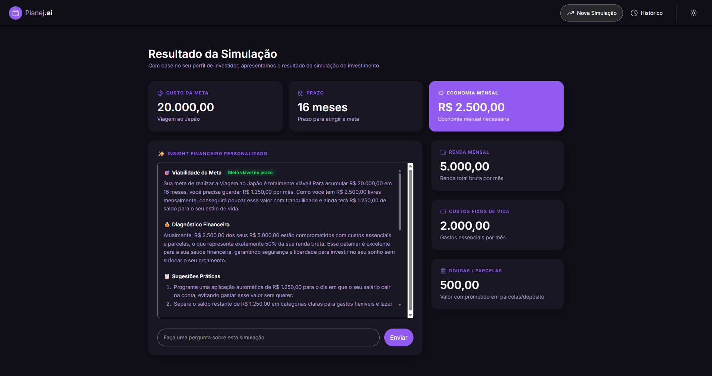
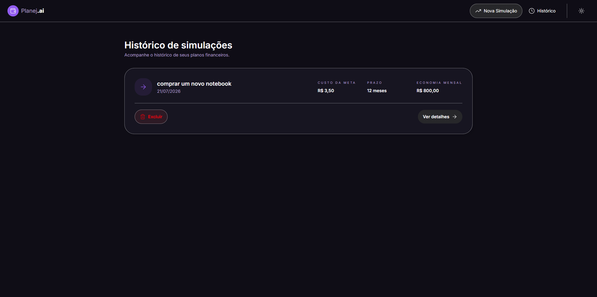

<div align="center">

# 💸 Planej.ai

**Planeje suas metas financeiras com simulações claras e insights assistidos por inteligência artificial.**

Aplicação web desenvolvida com **React, TypeScript, Vite e Tailwind CSS**, focada em organização de metas, análise estimada do orçamento e acompanhamento de simulações.

[🌐 Acessar demonstração](https://planejai-rosy.vercel.app/) · [💻 Ver código-fonte](https://github.com/AlbericoJr/planejai) · [🐛 Reportar problema](https://github.com/AlbericoJr/planejai/issues)

</div>

---

## 📖 Sobre o projeto

O **Planej.ai** é um projeto de planejamento financeiro pessoal. A partir de informações de renda, despesas, dívidas e uma meta definida pelo usuário, a aplicação organiza os valores, apresenta um resumo da simulação e permite consultar análises textuais geradas por IA.

O objetivo é tornar o planejamento de metas mais visual e acessível, enquanto o projeto explora construção de interfaces com React, tipagem com TypeScript, persistência local e integração com uma API generativa.

> **Estado atual:** projeto frontend em evolução. A integração com a API Gemini é experimental e **ainda precisa ser migrada para um backend seguro** antes do uso com credenciais reais em produção.

## 🖥️ Demonstração e capturas

**Aplicação publicada:** https://planejai-rosy.vercel.app/

### Página inicial



### Formulário de simulação



### Histórico de simulações



## ✨ Funcionalidades

- **Simulação em etapas:** preenchimento de renda mensal bruta, custos fixos, dívidas ou parcelas, nome da meta, custo e prazo desejado.
- **Resumo financeiro:** exibição dos principais valores informados e da sobra mensal estimada.
- **Análise assistida por IA:** geração de diagnóstico, sugestões, alternativas de renda extra e orientações textuais relacionadas à meta, quando a integração está configurada e disponível.
- **Conversa contextual com IA:** perguntas adicionais com referência aos dados da simulação, ao diagnóstico gerado e às últimas mensagens.
- **Histórico local:** consulta, abertura e exclusão de simulações armazenadas no navegador.
- **Tema claro e escuro:** preferência visual persistida localmente.
- **Interface responsiva:** layout adaptado para diferentes tamanhos de tela.

### Como o cálculo funciona

O resumo exibe a **sobra mensal estimada** conforme a fórmula atualmente implementada:

```text
Sobra mensal estimada = renda mensal bruta − custos fixos − dívidas/parcelas
```

A estimativa **não equivale necessariamente ao dinheiro disponível para investir ou poupar**: impostos, despesas variáveis e gastos não informados podem alterar o resultado. O valor mensal necessário para a meta é considerado no contexto enviado à IA, mas não substitui um planejamento financeiro detalhado.

## 🛠️ Tecnologias

| Categoria | Tecnologias |
| --- | --- |
| Interface | React 19, TypeScript, React Router |
| Estilização | Tailwind CSS 4, CSS, Lucide React |
| Ferramentas | Vite 8, ESLint, Prettier |
| Experiência visual | React Loading Skeleton |
| Persistência | `localStorage` do navegador |
| IA experimental | API Gemini via `fetch` |

**Arquitetura atual:** aplicação frontend; não há backend próprio para armazenar simulações ou intermediar de maneira segura as chamadas à IA.

## 🚀 Executando localmente

### Pré-requisitos

- **Node.js 20.19+ ou 22.12+** (ou uma versão posterior compatível com Vite 8).
- **npm**.
- **Git** para clonar o repositório.

### 1. Clone o projeto

```bash
git clone https://github.com/AlbericoJr/planejai.git
cd planejai
```

### 2. Instale as dependências

```bash
npm ci
```

### 3. Inicie a aplicação

```bash
npm run dev
```

Abra a URL exibida no terminal, geralmente **http://localhost:5173/**. A porta poderá ser diferente se a padrão estiver ocupada.

> **Importante:** as telas, o formulário e o histórico local podem ser explorados sem cadastrar uma chave de API. Nesse cenário, a geração de respostas por IA não funcionará corretamente e poderá exibir um erro de integração.

### Configuração da IA: atenção à segurança

A implementação atual em `src/services/aiService.ts` utiliza `import.meta.env.VITE_GEMINI_API_KEY` e envia requisições **diretamente do navegador** à API Gemini.

**Esse modelo não protege a chave.** Variáveis com prefixo `VITE_` utilizadas no frontend são incorporadas ao código entregue ao cliente durante o build. Deixar o arquivo `.env` fora do Git **não impede essa exposição**.

Por isso, **não configure uma chave secreta real em um deploy público** com a arquitetura atual. Antes de habilitar a integração em produção, implemente uma API no servidor ou uma função serverless que:

1. Armazene a chave em uma variável de ambiente **exclusiva do servidor**, sem prefixo `VITE_`.
2. Receba e valide as solicitações da aplicação.
3. Faça a chamada ao provedor de IA no servidor.
4. Aplique limites de requisição, tratamento de erros e medidas contra abuso.
5. Retorne ao frontend apenas os dados necessários à interface.

Referência: [documentação oficial de variáveis de ambiente do Vite](https://vite.dev/guide/env-and-mode).

**Se uma chave real já foi utilizada no frontend publicado, considere-a exposta: revogue ou substitua a credencial e revise seu uso no provedor.**

## 📁 Organização do projeto

```text
planejai/
├── public/                # Arquivos públicos
├── src/
│   ├── assets/            # Imagens e recursos visuais
│   ├── components/        # Componentes e funcionalidades de interface
│   ├── context/           # Contexto de tema
│   ├── data/              # Estruturas de dados e prompts de IA
│   ├── hooks/             # Estado e persistência das simulações
│   ├── pages/             # Formulário, resultados e histórico
│   ├── services/          # Integração atual com a API Gemini
│   ├── styles/            # Estilos adicionais
│   ├── utils/             # Cálculos e formatação
│   ├── App.tsx
│   ├── router.tsx
│   └── main.tsx
├── index.html
├── package.json
└── vite.config.ts
```

## 🧰 Comandos disponíveis

| Comando | Ação |
| --- | --- |
| `npm run dev` | Inicia o servidor de desenvolvimento |
| `npm run build` | Executa a verificação TypeScript e gera o build |
| `npm run preview` | Visualiza o build localmente |
| `npm run lint` | Analisa o código com ESLint |
| `npm run lint:fix` | Aplica correções automáticas possíveis |
| `npm run format` | Formata arquivos com Prettier |

**Verificações sugeridas antes de publicar alterações:**

```bash
npm run lint
npm run build
```

O repositório **ainda não possui um script de testes automatizados** configurado no `package.json` consultado. Os comandos acima verificam análise estática e build, mas não substituem testes funcionais.

## 🔐 Privacidade e limitações atuais

- **Dados armazenados no navegador:** simulações e conversas ficam no `localStorage` do dispositivo, sem conta de usuário e sem sincronização entre dispositivos.
- **Persistência limitada:** limpar os dados do navegador ou usar outro navegador/dispositivo pode eliminar o acesso ao histórico.
- **Envio de dados à IA:** quando a integração é acionada, informações financeiras fornecidas na simulação e trechos da conversa são enviados ao serviço Gemini para geração de respostas.
- **Chave da API no frontend:** a arquitetura atual não fornece proteção adequada para uma credencial secreta. A migração para backend é uma prioridade.
- **Resultados estimados:** os cálculos dependem das informações cadastradas, e respostas da IA podem conter imprecisões.
- **Sem recomendação financeira profissional:** o Planej.ai é um projeto educacional e demonstrativo, não uma plataforma de consultoria financeira ou aconselhamento de investimentos.

Evite inserir informações financeiras sensíveis ou identificadores pessoais reais enquanto a integração e os controles de privacidade estiverem em desenvolvimento.

## 🗺️ Próximos passos

- [ ] Migrar a integração Gemini para uma função serverless ou backend protegido.
- [ ] Adicionar validação dos dados de entrada e da estrutura de respostas da IA.
- [ ] Corrigir a nomenclatura da sobra mensal e aprimorar os cálculos considerando mais despesas.
- [ ] Implementar testes unitários e de fluxo para simulações, histórico e integração de IA.
- [ ] Melhorar acessibilidade, estados de erro e tratamento de respostas inesperadas.
- [ ] Adicionar opções de exportação e limpeza do histórico local.
- [ ] Configurar validações automatizadas com GitHub Actions.

## 🤝 Como contribuir

Sugestões, melhorias e correções são bem-vindas.

1. Abra uma [issue](https://github.com/AlbericoJr/planejai/issues) explicando a proposta ou o problema.
2. Crie uma branch descritiva, como `feat/nome-da-feature` ou `fix/nome-do-ajuste`.
3. Faça as alterações e execute `npm run lint` e `npm run build`.
4. Abra um pull request descrevendo o que mudou e como validar.

## 📄 Licença

**Ainda não há um arquivo `LICENSE` definido neste repositório.** As condições de reutilização e distribuição devem ser esclarecidas com o autor. Uma licença poderá ser adicionada futuramente.

## 👨‍💻 Autor

**Albérico Júnior** — Desenvolvedor Front-end & Mobile

- [GitHub](https://github.com/AlbericoJr)
- [LinkedIn](https://www.linkedin.com/in/alberico-junior/)
- [Portfólio](https://albericojr-portfolio-xi.vercel.app/)

---

<div align="center">

**Planej.ai — transforme suas metas em planos mais claros.**

</div>
